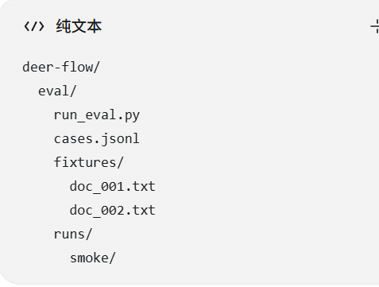

# 评测入口、评分标准与对比测试

## 评测

来源：`df/评测入口/评测.md`

**建原文件**
nano eval/fixtures/docx_1.txt    //格式_名称.txt  ,每个测试文件都要一个 ，里面粘贴文件内容

**建用例文件**
nano eval/cases.jsonl    //{"id":"docx_1","task":"把文档里的数字按升序排列","base":"fixtures/docx_1.txt","ground_truth":[{"type":"wrong_order","locator":"第1段","quote":"1 3 4 2 6 5"}]}

**建评分标准**
nano eval/scoring.md
# 评分标准 v0.1
要写进readme

## 命中规则
critic 的一条 issue 满足以下任一条件，算命中：
1. type 相同，且 locator 去掉空格后相同；
2. anchor 与标准答案的 quote 归一化后互相包含。

匹配一对一，顺序无关。

## 计数
- TP：命中的标准问题数
- FP：critic 报了但没对上标准答案的 issue 数
- FN：标准答案里没被命中的问题数
- invalid：JSON 不合法、缺字段、anchor 找不到的用例数，单独统计

## 指标
召回率 = TP / (TP + FN)
精确率 = TP / (TP + FP)
F1 = 2 × (precision × recall) / (precision + recall) 【0，1】数值越大平衡越好

severity 不参与匹配。

**建结果表**
nano eval/results.csv
case_id,ground_truth_count,TP,FP,FN,invalid,notes   //表头  //notes写命中/漏报/格式错误
> [图片已省略：Pasted image 20261114150628.png]
**去deerflow里跑文件**

用 doc-processor 分析这份文档，输出 analysis JSON；然后让 critic 审查这个结果。

## 机制

来源：`df/评测入口/机制.md`

**格式化输出不是两个子 agent 互相传递**
**leader负责将文档和用户要求传给doc-->**//leader传的文件必须是保留结构的 JSON，不能是文本
审查文档方式 ，里双列排版 ，如若未保留结构，会给ai留空，进行编造内容
**doc负责阅读分析文档并且做好锚点进行原文+笔记+锚点的格式化输出给critic-->**
**critic对doc的输入内容进行根据rubric进行评审，有问题就加上issue,保证固定的schema返给doc-->**
**doc根据和issue做编辑式输出原文+锚点+改进的格式化输出给leader-->**
**leader最后进行总结调用工具生成文档**

> [图片已省略：Pasted image 20261115142940.png]

## 未命名

来源：`df/评测入口/未命名.md`

（文件引用：评测入口.py）

## 评分标准

来源：`df/评分标准.md`

# 评分标准 v0.1

## 命中规则
critic 的一条 issue 满足以下任一条件，算命中：
1. type 相同，且 locator 去掉空格后相同；
2. anchor 与标准答案的 quote 归一化后互相包含。

匹配一对一，顺序无关。

## 计数
- TP：命中的标准问题数
- FP：critic 报了但没对上标准答案的 issue 数
- FN：标准答案里没被命中的问题数
- invalid：JSON 不合法、缺字段、anchor 找不到的用例数，单独统计

## 指标
召回率 = TP / (TP + FN)
精确率 = TP / (TP + FP)

severity 不参与匹配。

## 对比测试

来源：`df/对比测试.md`

**只给笔记**：
TP=12, FP=16, FN=3
recall=80%  precision=42.9%  F1 = 55.8%
**原文+笔记，增加范围约束，收紧锚点契约**：
TP=15, FP=6, FN=0
recall=100%  precision = 71.4%  F1 = 88.3%
