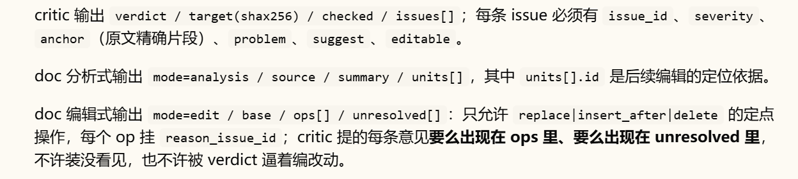

# 评审循环、返工与兜底

## doc --critic

来源：`df/critic机制/评审循环/doc --critic.md`

leader分配工作->doc 负责读->critic 负责审->leader写
 |                                                                                 |or
|--------------------------------------------------------|
**精确锚点**（否则它无法定位）、**逐字引用的硬要求**（否则无法验证）、**NOT_FOUND 逃生口**（否则它会编一个看起来合理的段落填进去）。

critic problem
**保证输入里有原文和锚点**
**prompt只能要求不能保证，所以再添加代码侧做校验和重试**
**这些操作是为了让召回率更可测量**
关于critic返回意见的文本格式
critic审完给leader 发给doc的格式
任务：只重取一段原文。
产物（只读参考）：run/<id>/v1/notes.md
你上一版对「第 3 页 / 第 12 段」给出的 quote 是：
  "……"
我在原文同位置读到的是：
  "……"

只做一件事：回传该段逐字原文，不超过 300 字。
不要总结，不要补充其他段落，不要修改措辞。
若该段在原文中不存在，回答 NOT_FOUND，并给出最接近的段落编号。

## 兜底机制

来源：`df/critic机制/评审循环/兜底机制.md`

**评审死循环**
每次产出都要分别保存（v1、v2 各自保存到文件），最后从候选池里选优，而不是直接拿最后一版。这是整个机制里收益最高的一项，也是成本最低的一项，因为把结果保存到文件不需要任何模型调用。

token消耗到max_tokens的85%时，开始输出最终值

**选优必须分三层，并且尽量停在上层

第一层用代码判定，不使用模型：文件能否打开、每条笔记的引文是否真的出现在原文对应位置、结构节点数是否与输入一致、有没有 TODO 或空段落。如果这一层不通过，就淘汰。这一层的价值在于，它能筛掉大部分“越改越坏”的产物，而且成本为零。

第二层比较数字，不比较散文：critic 必须用结构化字段返回（`blocking` 数组、`advisory` 数组），选阻断项最少、其次建议项最少的候选。不能让我“读一遍，感觉 v2 更好”；那又回到自由裁量了。

第三层在平票时取版本号最小的候选。早期版本最贴近原始意图，后期版本是为通过审查而修改的，已经对 critic 的偏好过拟合了。

> [图片已省略：Pasted image 20261114101649.png]
